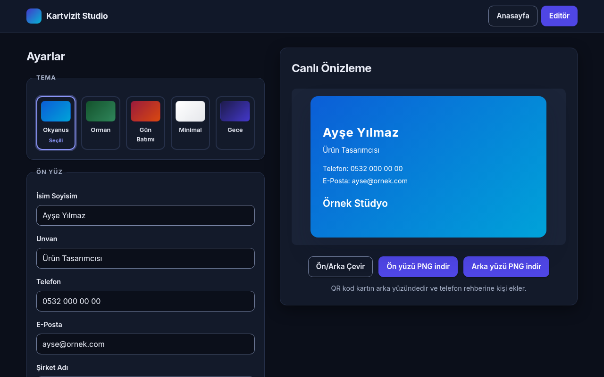

# Kartvizit Studio

Tarayıcıda çalışan, kurulum gerektirmeyen kartvizit tasarım aracı. Bilgilerini gir, hazır temalardan birini seç, kişi bilgilerini içeren QR kodlu kartvizitini PNG olarak indir.

**Canlı demo:** [cardstudio-gamma.vercel.app](https://cardstudio-gamma.vercel.app/)



## Özellikler

- Canlı önizleme, ön/arka yüz çevirme (3D)
- 5 hazır tema (Okyanus, Orman, Gün Batımı, Minimal, Gece) ve özel renk seçimi
- Kartın arka yüzünde vCard 3.0 QR kodu (telefon kamerasıyla okutunca rehbere kişi eklenir)
- Ön ve arka yüzü ayrı ayrı yüksek çözünürlüklü PNG olarak indirme
- Girdiler `localStorage` içinde saklanır; sayfa yenilenince kaybolmaz ("Varsayılana dön" ile sıfırlanır)
- Mobil uyumlu (360px'e kadar test edildi), etiketli form alanları, klavye ile kullanım, yüksek kontrast
- Framework ve build adımı yok: saf HTML, CSS ve JavaScript

## Çalıştırma

Statik bir sitedir. İki yol:

```bash
# 1) Dosyayı doğrudan aç
xdg-open index.html     # macOS: open, Windows: start

# 2) Yerel sunucu
npx serve .
```

Not: PNG indirme ve QR kodu için CDN'den iki kütüphane yüklenir (sabit sürüm, SRI doğrulamalı): `html2canvas 1.4.1` ve `qrcode-generator 1.4.4`. İnternet bağlantısı gerekir.

Yayınlamak için klasörü olduğu gibi herhangi bir statik barındırmaya (Vercel, Netlify, GitHub Pages) yükleyebilirsin; `index.html` kökte.

## Dosya yapısı

```
index.html     Ana sayfa (demo kart)
editor.html    Editör
css/           style.css (ortak + kart), editor.css
js/            main.js (ana sayfa), editor.js (editör mantığı)
```

## Bilinen sınırlar

- Çok uzun metinlerde QR kod kapasitesi aşılabilir; uyarı gösterilir.
- Yazı tipi sistem yazı tipidir; PNG çıktısı kullanılan cihazın yazı tipine göre değişebilir.

## Lisans

MIT, bkz. [LICENSE](LICENSE).
